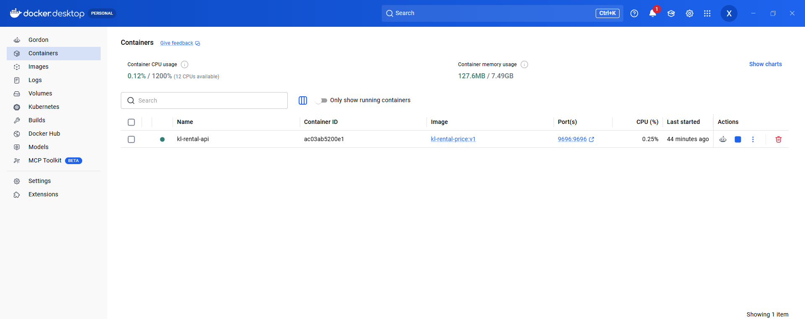
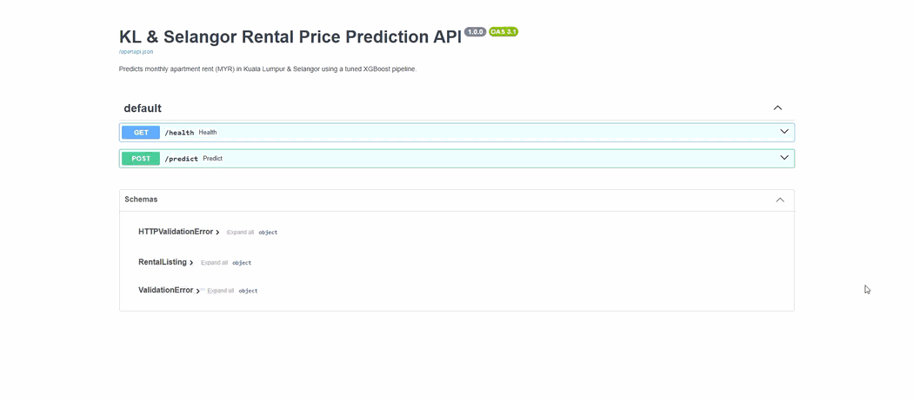
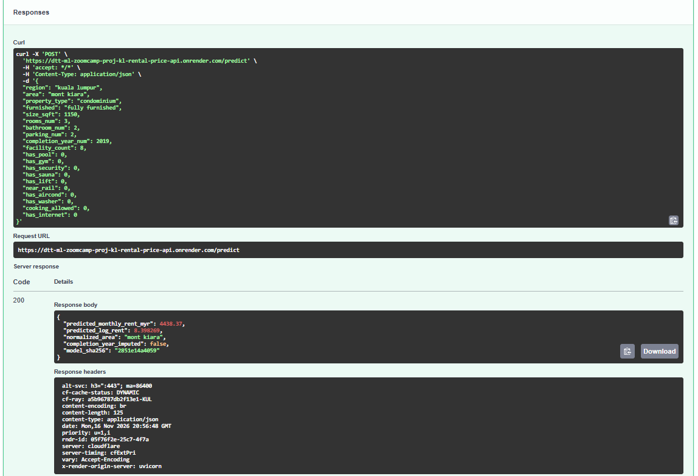
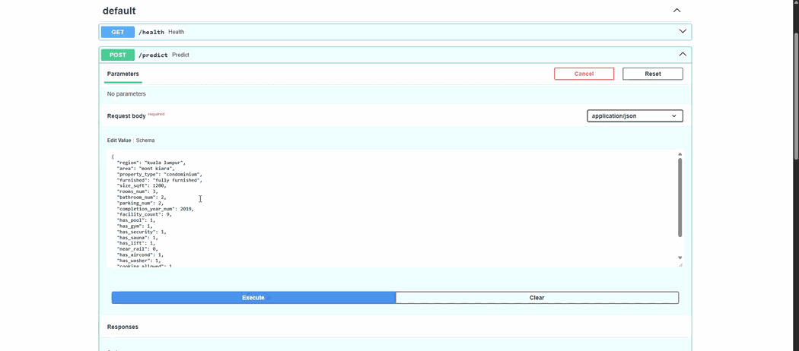
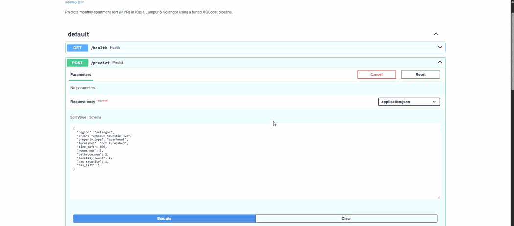
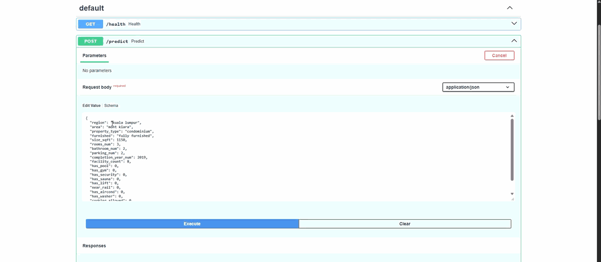
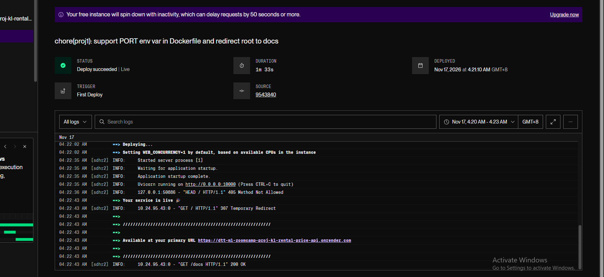
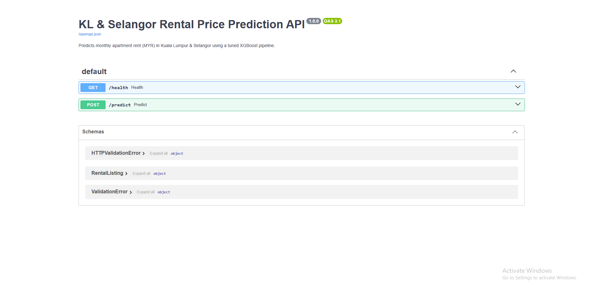
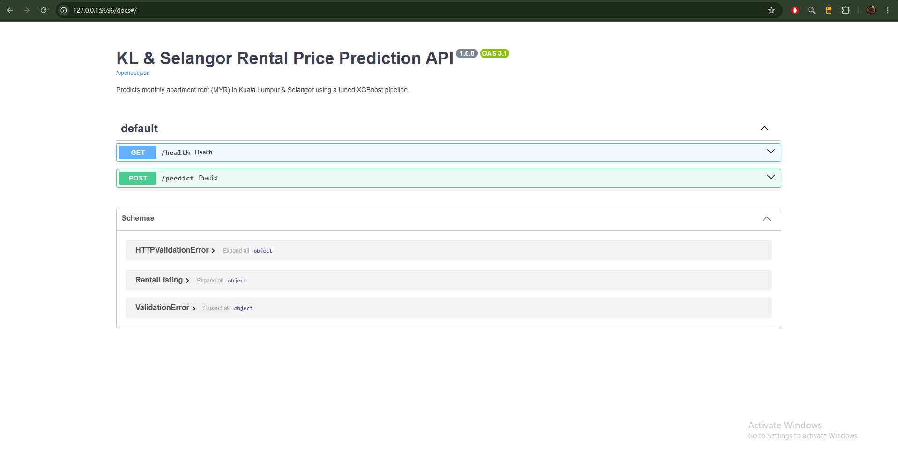

# Klang Valley (Kuala Lumpur & Selangor) Rental Price Prediction

**Course:** DataTalksClub Machine Learning Zoomcamp 2026 — Midterm Project 1  
**Author:** Chin Xue Rong (XR)  
**Live API (Swagger UI):** https://dtt-ml-zoomcamp-proj-kl-rental-price-api.onrender.com/docs *(Render Free tier: allow ~30–60s cold start after inactivity)*

An end-to-end machine learning pipeline and containerized **FastAPI** web service that predicts fair monthly apartment rent (`monthly_rent` in **MYR**) across **Kuala Lumpur** and **Selangor**.

---

## 1. Problem Description & Solution Overview

### The Operational Problem
In the Klang Valley residential rental market, monthly asking rents vary sharply within the same township—a 1,000 sq. ft. condominium in areas such as Mont Kiara, Cheras, Taman Desa, or Subang Jaya can rent anywhere from **RM 1,200 to RM 4,000+** depending on unit size, township prestige, furnishing tier, parking bays, building age, and condominium amenities.

* **Landlords & Property Agents** often price listings by guesswork or unadjusted neighbor ads, risking **overpricing** (months of vacancy) or **underpricing** (lost rental yield).
* **Tenants & Relocating Professionals** lack a quick, objective valuation check to benchmark whether a quoted monthly rent aligns with comparable Klang Valley properties before signing a tenancy agreement.

### How This Solution Works
This project turns ~20k historical Mudah.my listings into a reproducible valuation pipeline:
1. **Exploratory Analysis & Domain Cleaning ([`kl-price-pred.ipynb`](kl-price-pred.ipynb)):** Parses noisy rental strings, removes duplicate reposts and scraper noise, validates three hypotheses (`H1` location/furnishing dominance, `H2` controlled amenity premiums, `H3` non-linear tree gains over linear models), and benchmarks **7 model families**.
2. **Automated Reproducible Training ([`train.py`](train.py)):** Trains the winning **`XGBRegressor`** pipeline on `log1p(monthly_rent)` using strictly training-fitted area bucketing (`top 50` townships + `"other"`) and `completion_year_num` median imputation, exporting [`model.bin`](model.bin) and [`model_metadata.json`](model_metadata.json).
3. **Real-Time Prediction API ([`predict.py`](predict.py)):** Exposes `GET /health` and `POST /predict` via **FastAPI + Uvicorn**, packaged with **uv** and **Docker**. Strict Pydantic validation rejects unsupported categories or out-of-range dimensions with `HTTP 422` rather than returning silent zeroed-out predictions.

---

## 2. Dataset

* **File Included:** [`data/mudah-apartment-kl-selangor.csv`](data/mudah-apartment-kl-selangor.csv) (`19,991` raw rows, `14` columns, ~4.8 MB)
* **Source:** Rental Pricing Dataset, Malaysia (Mudah.my apartment/condominium listings for Kuala Lumpur & Selangor, Kaggle: `ariewijaya`)
* **Cleaning & Engineering Summary:**
  * Deduplicated by `ads_id` and canonicalized non-ID attributes (catching shuffled facility reposts).
  * Parsed currency strings (`"RM 4 200 per month"`) and size strings (`"1842 sq.ft."`), enforcing realistic residential bounds (`monthly_rent` RM 300–25,000, `size_sqft` 250–5,000, PSF RM 0.40–15.00, `rooms` 1–6, `bathroom` 1–6, `parking` 0–4).
  * Filtered numeric Mudah scraper noise from `area` and `facilities`, added missingness flags (`has_parking_info`, `has_completion_year`), and engineered `22` features (`17,601` clean rows total).

---

## 3. Key Findings (EDA, Feature Importance & Benchmarks)

### Core Insights
* **H1 Confirmed (Location, Size & Furnishing Drive Rent):** **`size_sqft`** (`0.130` permutation importance) and **`area`** (`0.107` permutation importance / `51.0%` XGBoost split gain) plus **`furnished`** (`0.055`, `15.4%` gain), **`property_type`** (`0.041`), **`completion_year_num`** (`0.031`), and **`region`** (`0.027`) account for the bulk of predictive signal. KL exhibits roughly double Selangor's marginal price-per-sqft slope.
* **H2 Confirmed (Controlled Amenity Lift):** Controlling within `condominium` + `partially furnished` reveals `+RM 50–100/mo` median premiums for `has_pool`, `has_gym`, `has_sauna`, `has_aircond`, `has_washer`, and `has_security`, with positive out-of-sample permutation signal from `facility_count` (`0.0075`), `has_gym` (`0.0036`), `has_internet` (`0.0032`), `has_aircond` (`0.0027`), and `has_sauna` (`0.0026`).
* **H3 Confirmed (Tree Boosting Beats Linear & Neural Baselines):** Multiplicative interactions between location, size, and furnishing favor gradient-boosted trees over `Ridge` and `MLPRegressor`.

### 7-Model Validation Leaderboard (`60/20` Split, `n_val = 3,520`)

| Rank | Model | Val RMSE (MYR) | Val MAE (MYR) | Val Log-RMSE | vs. Ridge RMSE |
| :--- | :--- | :---: | :---: | :---: | :---: |
| **1** | **XGBoost (`lr=0.03, depth=6, n=2024`)** | **397.20** | **217.83** | **0.1799** | **-15.03%** |
| 2 | HistGradientBoosting (`lr=0.05, leaves=63, min_leaf=20`) | 401.60 | 226.84 | 0.1850 | -14.08% |
| 3 | RandomForest (`depth=20, mf=1.0, n=300`) | 421.74 | 230.13 | 0.1950 | -9.77% |
| 4 | ExtraTrees (`depth=None, leaf=1`) | 436.98 | 238.41 | 0.2060 | -6.51% |
| 5 | Ridge (`alpha=500.0`, StandardScaler) | 467.43 | 281.43 | 0.2237 | 0.00% |
| 6 | MLPRegressor (`hidden=(128,64), alpha=0.1`) | 481.38 | 283.33 | 0.2288 | +2.98% |
| 7 | Dummy (Median Baseline) | 907.29 | 542.07 | 0.4354 | +94.10% |

### Stratified 5-Fold CV (`df_full_train`, `n = 14,080`) & Final Holdout Test (`n = 3,521`)

* **5-Fold CV (zero-leakage preprocessor refit per fold):**
  * **XGBoost:** `RM 375.36 ± 16.81` RMSE | `RM 210.44` MAE | `0.1758` Log-RMSE
  * **HistGradientBoosting:** `RM 400.32 ± 15.13` RMSE | `RM 224.54` MAE | `0.1840` Log-RMSE
  * **RandomForest:** `RM 418.17 ± 30.17` RMSE | `RM 225.28` MAE | `0.1905` Log-RMSE
  * **Ridge:** `RM 469.57 ± 10.01` RMSE | `RM 282.37` MAE | `0.2225` Log-RMSE
* **Untouched Holdout Test (`n = 3,521`):**
  * **Log-RMSE:** `0.1877` | **MAE:** `RM 222.82` | **Median AE:** `RM 122.74` | **Median % Error (MdAPE):** **`8.92%`** (`8.72%` KL / `9.02%` Selangor) | **RMSE:** `RM 520.31` (driven by luxury tail units > RM 4,000 and scarce `townhouse condo` listings).

---

## 4. Repository Structure

```text
proj1-kl-rental-price-prediction/
├── assets/                               # Demo GIFs & deployment verification screenshots
├── data/
│   └── mudah-apartment-kl-selangor.csv   # Committed dataset (~4.8 MB)
├── kl-price-pred.ipynb                   # Full EDA, H1-H3 tests, 7-model benchmark & CV
├── features.py                           # Shared feature constants, normalizers & schema prep
├── train.py                              # Reproducible training script -> model.bin + metadata
├── predict.py                            # FastAPI inference service (GET /health, POST /predict)
├── smoke_test.py                         # Offline parity, schema validation & live HTTP test
├── model.bin                             # Serialized preprocessor + DictVectorizer + XGBRegressor
├── model_metadata.json                   # Training SHA-256, versions & holdout metrics
├── pyproject.toml                        # Project & dependencies (runtime vs dev group)
├── uv.lock                               # Locked reproducible resolution
├── requirements.txt                      # Exported pip-compatible lock list
├── .python-version                       # Python 3.14.3
├── .dockerignore
└── Dockerfile                            # Containerized uvicorn service (default port 9696 / $PORT)
```

---

## 5. Setup & Reproducibility

### Option A — Using `uv` (Recommended)

```bash
# 1. Create virtual environment & install locked dependencies (runtime + notebook/training tools)
uv sync

# 2. Activate virtual environment
# Linux / macOS:
source .venv/bin/activate
# Windows PowerShell:
.\.venv\Scripts\Activate.ps1
```

### Option B — Using `venv` + `pip`

```bash
python -m venv .venv
# Linux / macOS: source .venv/bin/activate
# Windows PowerShell: .\.venv\Scripts\Activate.ps1

pip install -r requirements.txt
```

### Re-running Training & Notebook

```bash
# Re-train final XGBoost model from data/mudah-apartment-kl-selangor.csv -> model.bin
python train.py
```

To explore or re-execute the full analysis interactively, open [`kl-price-pred.ipynb`](kl-price-pred.ipynb) in Jupyter/VS Code using the `.venv` Python kernel and run all cells (`1..18`).

---

## 6. Running & Testing the FastAPI Service Locally

Start the API server on port `9696`:

```bash
uvicorn predict:app --host 0.0.0.0 --port 9696
```

Interactive Swagger docs are available at `http://127.0.0.1:9696/docs`.

### Request Schema & Validation Rules (`POST /predict`)

To prevent `DictVectorizer` from silently zeroing out invalid categories, categorical fields are validated case-insensitively (`HTTP 422` on invalid values):

* `region` (**required**): `"kuala lumpur"` or `"selangor"`
* `area` (**required**): Township name (e.g., `"mont kiara"`, `"klcc"`, `"cheras"`, `"subang jaya"`); unseen KL/Selangor townships map cleanly to `"other"`
* `property_type` (default `"condominium"`): `"condominium"`, `"apartment"`, `"service residence"`, `"flat"`, `"studio"`, `"duplex"`, `"townhouse condo"`, `"others"`
* `furnished` (default `"partially furnished"`): `"fully furnished"`, `"partially furnished"`, `"not furnished"`
* `size_sqft` (**required**): `250`–`5000`
* `rooms_num` (**required**): `1`–`6`
* `bathroom_num` (**required**): `1`–`6`
* `parking_num` (optional, `null` allowed): `0`–`4` (`has_parking_info` is inferred automatically)
* `completion_year_num` (optional, `null` allowed): `1960`–`2035` (`null` uses training median `2017.0` and sets `has_completion_year = 0`)
* `facility_count` (optional, default `0`, range `0`–`14`): Send the count when known (omitting it has minimal impact—around ~1.4% shift on tested examples)
* Binary facility flags (`0` or `1`, default `0`): `has_pool`, `has_gym`, `has_security`, `has_sauna`, `has_lift`, `near_rail`, `has_aircond`, `has_washer`, `cooking_allowed`, `has_internet`

### Sample Request (`curl`)

```bash
curl -s http://127.0.0.1:9696/health

curl -s -X POST http://127.0.0.1:9696/predict \
  -H "Content-Type: application/json" \
  -d '{
    "region": "kuala lumpur",
    "area": "mont kiara",
    "property_type": "condominium",
    "furnished": "fully furnished",
    "size_sqft": 1200,
    "rooms_num": 3,
    "bathroom_num": 2,
    "parking_num": 2,
    "completion_year_num": 2019,
    "facility_count": 9,
    "has_pool": 1,
    "has_gym": 1,
    "has_security": 1,
    "has_sauna": 1,
    "has_lift": 1,
    "near_rail": 0,
    "has_aircond": 1,
    "has_washer": 1,
    "cooking_allowed": 1,
    "has_internet": 1
  }'
```

Sample response:

```json
{
  "predicted_monthly_rent_myr": 4228.34,
  "predicted_log_rent": 8.349802,
  "normalized_area": "mont kiara",
  "completion_year_imputed": false,
  "model_sha256": "2851e14a4059"
}
```

### Automated Smoke Test

Runs both positive prediction checks and `6` strict `HTTP 422` rejection checks (`region="penang"`, `furnished="fully-furnished"`, `rooms_num=0`, etc.):

```bash
# Offline model + schema validation check:
python smoke_test.py --offline-only

# Full HTTP check against running server (port 9696):
python smoke_test.py --http-only
```

---

## 7. Containerization (Docker)

The [`Dockerfile`](Dockerfile) installs only the lean runtime dependencies via `uv sync --locked --no-dev` (plus `libgomp1` for XGBoost OpenMP) and reads `${PORT}` dynamically (`9696` default locally):

```bash
# Build image
docker build -t kl-rental-price:v1 .

# Run container (with an explicit container name)
docker run --rm --name kl-rental-api -p 9696:9696 kl-rental-price:v1

# Verify containerized endpoints in another terminal
python smoke_test.py --http-only
```



*(Observed container footprint running live on Docker Desktop: `127.6 MiB` RAM.)*

---

## 8. Cloud Deployment (Render) & Live Demo

The containerized API is deployed live on **Render** (Docker Web Service, Free tier, `$0/month` — well within the 512 MiB limit at ~128 MiB runtime memory):

* **Live Swagger UI:** https://dtt-ml-zoomcamp-proj-kl-rental-price-api.onrender.com/docs *(root `/` redirects to `/docs`)*
* **Health Check:** https://dtt-ml-zoomcamp-proj-kl-rental-price-api.onrender.com/health
* **Cold-start note:** Render's free tier spins down after 15 minutes of inactivity, so the first request after idle takes **~30–60 seconds** to wake up automatically.

### Cloud Setup & Verification

* **Render Web Service Settings:** Repository `Xu3Rong/dtt-ml-zoomcamp-homework` | Branch `main` | Root Directory `proj1-kl-rental-price-prediction` | Runtime `Docker` (`Dockerfile` uses `CMD ["sh", "-c", "exec uvicorn predict:app --host 0.0.0.0 --port ${PORT}"]` to bind Render's injected `$PORT`).
* **Automated Cloud Smoke Test (`GET /health`, KL & Selangor `POST /predict`, and 6 `HTTP 422` validation checks):**
  ```bash
  python smoke_test.py --http-only --url https://dtt-ml-zoomcamp-proj-kl-rental-price-api.onrender.com
  ```

### Live Swagger UI Walkthrough



### Cloud Request & Render Deploy Verification



<details>
<summary>More demo GIFs & deployment screenshots (KL condo, Selangor imputed apartment, 422 validation guard, Render & local docs)</summary>

#### Test 1 — Prime KL Mont Kiara Condominium (`200 OK`)


#### Test 2 — Selangor Budget Apartment with Missing Optional Fields (`200 OK`, `"other"` area & median year imputed)


#### Test 3 — Strict Schema Guardrail Rejecting Unsupported Region (`HTTP 422`)


#### Render Deployment Logs & Local Container Docs




</details>

---

## 9. Limitations & Future Work

* **Omitted Unstructured Building Identity (`prop_name`):** Intentionally excluded so the API stays generalizable without requiring exact condominium spelling lookups; however, luxury/boutique buildings inside the same township command different rents, contributing to wider residuals above `RM 4,000`.
* **Missing Micro-Attributes:** The source dataset does not record floor level, interior renovation quality, or exact walking distance to LRT/MRT stations.
* **Future Improvements:** Out-of-fold target encoding for top condominium developments, quantile/prediction-interval outputs (`p10`–`p90`), and a custom frontend UI consuming the `/predict` endpoint.
